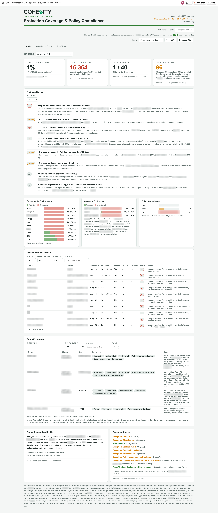

Copyright Cohesity 2026, SPDX-License-Identifier: Apache-2.0

# Cohesity Protection Coverage & Policy Compliance Audit

**Author:** Akshay Kumar, Dir, Solutions Architecture ([akshay.kumar2@cohesity.com](mailto:akshay.kumar2@cohesity.com))

A Claude skill, also available as a Microsoft Copilot Studio agent, that audits your Cohesity protection posture from live Helios data and publishes it as a live, private Claude Artifact (its refresh schedule can be set in the page's Settings tab): what is not protected, which policies miss your standards, which protection groups are paused or violating their SLA, and whether source registrations are healthy.

- Claude skill: [`claude/Cohesity-Protection-Coverage-Audit/SKILL.md`](claude/Cohesity-Protection-Coverage-Audit/SKILL.md) (the full page template is embedded in it)
- Output: one claude.ai **Artifact** titled `Cohesity Protection Coverage And Policy Compliance Audit` (no static HTML file)
- Refresh: optional, and set in the page's **Settings** tab (card "Refresh schedule": frequency, day, time, time zone, on or off). The skill never asks about a schedule. After you save, the card says "Not applied yet" and shows an **Apply in Claude** link that opens a Claude chat with the command typed in; press Enter and the skill (in schedule-only mode, no Helios calls, no new data) reads your saved request, creates or updates the scheduled task `cohesity-protection-coverage-refresh` (the time you pick is converted from the time zone you pick to the local time of the machine running Claude, and the page shows both, for example "weekdays at 09:00 Asia/Kolkata (local 22:30 Sun-Thu)"; daylight saving changes can shift the local run time by one hour; turning it off disables the task, it is not deleted) and updates only the schedule on the page. Any normal run also applies a saved request first. The card shows what the skill saw at its last run, so a change made in Claude Desktop or on the web shows there after the next run. It needs Claude open on that computer; scheduled tasks may be moved to the cloud later. Without a schedule the page says nothing about refreshing and changes only when you run the skill.
- Data source: the **Helios MCP server** (Helios MCP connector). Everything is read-only.

## Two Versions

| | Claude skill | Microsoft Copilot Studio agent |
|---|---|---|
| Folder | [`claude/`](claude/Cohesity-Protection-Coverage-Audit/SKILL.md) | [`copilot-studio/`](copilot-studio/README.md) |
| Output | Live, private Claude Artifact; refresh schedule set in the Settings tab, never assumed | Answers in chat, with tables, on demand |
| Helios access | Helios MCP connector, read-only | Helios MCP server added as a tool, read-only |
| Setup | Install the skill in Claude (see Install below) | Paste `instructions.md`, upload `knowledge/` files, add the Helios MCP tool |
| Sample output | [claude/README.md](claude/README.md) | [copilot-studio/README.md](copilot-studio/README.md) |
| Model | Claude | GPT-5 Chat |

The sections below describe the Claude skill unless a heading says Copilot Studio.

## Sample output



Screenshots of every tab, with lab data and names blurred, are in [claude/README.md](claude/README.md).

## What you get

The Claude page has a single sun/moon theme button at the top right of the header. The page follows the browser setting and changes live with it; a click flips light/dark for this page view only, a browser change resets it, nothing is stored, and the button is hidden in print. A footer at the bottom reads "Copyright Cohesity 2026, SPDX-License-Identifier: Apache-2.0" and stays on the page when the Helios-unreachable banner is shown.

| Area | What it shows | Helios MCP tool |
|---|---|---|
| Cluster filter | Multi-select of all registered clusters; recalculates the KPIs, cluster coverage, policy table and exceptions in the browser | `dataprotect-get-clusters` |
| Table filters | Findings severity filter; policy table status, offsite, DataLock and search filters; exceptions table filtered by cluster, environment, exception type and search. Tables scroll with sticky headers. | none (client-side) |
| Landing widgets | Hero ring for Protection coverage %, tiles for Unprotected objects, Policies passing, Group exceptions, Failed last run, Paused, No DataLock and Stale sources, with delta chips; each tile is clickable and scrolls to the matching table, filtered | `dataprotect-search-objects`, `dataprotect-get-protection-policies`, `dataprotect-get-protection-groups` |
| Ranked findings | 3 to 8 findings rated high / medium / low, written from the data (large unprotected populations, failing policies, long-paused groups, SLA violations, stale registrations, clusters that could not be queried) | all of the below |
| Coverage by environment | Protected vs unprotected objects per environment, Helios-wide | `dataprotect-search-objects` |
| Coverage by cluster | Protected vs unprotected per connected cluster | `dataprotect-search-objects` |
| Policy compliance | Pass / warn / fail split plus a detail table: frequency, retention, offsite copy, DataLock, groups using the policy, status, issues | `dataprotect-get-protection-policies` |
| Header | Cohesity logo top-left; "Data last pulled <time> (N h ago)" top right; with a refresh schedule set, also "Refreshes <schedule>" and amber when older than 36 hours | none |
| Group exceptions | One row per group with chips for Paused (with age), SLA violated, Never run, Last run failed, **Replication stalled** and **Archive failed** (with "likely cause: replication stopped"), plus **Active snapshots, no DataLock** (read from each group's last run and its policy, no extra call), **Object protected by more than one group** (from `objectProtectionInfos` in the object search) and **Tag-based selection with zero objects** (VMware tag groups with no protected objects; needs a live tag group to confirm the field shape) | `dataprotect-get-protection-groups`, `dataprotect-search-objects` |
| Protected but at risk | Per cluster, the number of protected objects whose last protection run failed (shown in the Unprotected KPI and as a tooltip on the cluster bars) | `dataprotect-search-objects` |
| Failure priority (optional) | Failed, replication and archive exceptions get a **Priority** (0 to 100) and **Why** (reason and message code) column from one `troubleshooting-list-backup-failures` call (last 24 h), plus the line "Exceptions with a ranked failure: N of M". Only when Cohesity AI agents are turned on in Settings (off by default); when they are off, or the tool is missing, disabled or not licensed, the columns read n/a and the footnote says why. It never changes which groups are exceptions or any count. | `troubleshooting-list-backup-failures` |
| Source registration health | Unhealthy or stale registrations per cluster, plus a collapsible table of every source (cluster, source, environment, auth status, last refreshed, healthy) with CSV export | `dataprotect-get-source-registrations` |

Snapshots past retention and objects with no recent good backup moved to the **Cohesity-Recoverability-Evidence-Report** skill.

## Drill-down mode and what this replaces

One narrow question is answered in chat, without republishing the page:

- **Retention and replication of one protection group**: give a group name; the skill compares the policy's retention and replication targets with the last 10 runs and a sample of snapshots and reports snapshots past expiry and "likely cause: replication stopped". This is the function of `helios-retention-audit`.

It is folded in so one skill owns "protection posture". What it gains: a published page for the fleet-wide view that you can refresh, exact retention unit normalisation, de-duplicated registrations, and the page-level equivalents (the at-risk count and the replication / archive exceptions are computed for every cluster without per-object calls).

## Standards used (defaults)

The audit judges every policy against a baseline you can override in the request ("RPO 4 hours, keep 90 days"). The defaults are the skill's own baseline, **not** Cohesity or regulatory requirements, and the page footnote says so.

| Rule | Default | Result |
|---|---|---|
| Backup interval longer than `maxFreqHours` | 24 h (ProtectOnce policies exempt) | fail |
| Longest retention (base, extended or replication/archive copy) shorter than `minRetentionDays` | 30 days | fail |
| No offsite copy (no replication, archival, cloud vault, or `Archival` primary target) | | warn |
| No DataLock (WORM) on base retention | | warn |

Retention and schedule units come back mixed (Days, Weeks, Months, Years) whatever `durationUnit` says, so the skill normalises them (Weeks x 7, Months x 30, Years x 365).

## Requirements

- Claude desktop app (Cowork) with the **Helios MCP** connector (Controlled Availability: ask your Cohesity account team to enable it, then follow the Helios documentation topic *Helios MCP Server*).
- Artifacts available. A scheduler is optional and only needed for a refresh schedule you set in the Settings tab (the page also needs the page database and user identity capabilities for the Settings tab); scheduled tasks run only while the Claude app is open.

## Install

1. Zip the folder `claude/Cohesity-Protection-Coverage-Audit` so `SKILL.md` is inside it.
2. Add it as a custom skill in Claude (Settings, Skills, upload) or copy it into your skills directory.
3. Confirm the Helios MCP connector is connected.

## Use

- "Run the Cohesity protection coverage audit"
- "Which of my policies fail a 90-day retention standard?"
- "What is unprotected in Helios and what should I fix first?"
- "Refresh the protection audit"

The first run publishes the artifact (about 37 Helios calls for 5 connected clusters on a fresh run, up to 22 more on the fallback path, plus one `troubleshooting-list-backup-failures` call only when Cohesity AI agents are on; a later run on the same day reuses the object counts, which are under 20 hours old, and makes about 16 calls: clusters, groups, policies and source registrations; a cluster that times out on its groups call is skipped after one retry instead of being retried on every call type) and applies the refresh schedule you set in the Settings tab (a scheduled task, created or changed only from your saved request). Later runs republish to the same URL. The page is private until you share it from its Share menu.

## How coverage is counted

**Preferred path (one call):** the `protected-unprotected` report (`reporting-get-report-preview`, components 100 to 103) supplies per-environment protected and unprotected counts in a single call. The scope note shows "path: report". If the report is unavailable, empty, times out, has an unrecognised shape or fails a one-cluster tie check against `dataprotect-search-objects`, the skill falls back to the per-object counts below and shows "path: per-object counts". The report supplies the Helios-wide environment bars only: it does not tie to the per-object counts per cluster, so the per-cluster figures and the KPI always come from `dataprotect-search-objects`, and the skill reads the report's column names from the response.

**Duplicate protection scan** runs at most once a day (first run of the day, or when you ask for it). Other runs reuse the previous scan stored in the page (`dupScan`) and mark it "as of <time>".

**Empty-tag check** always runs: a VMware group with tag selection and zero protected objects is an exception; with no tag-based groups the page shows "No tag-based groups found: 0 empty (all clear)".

Fallback counting: `dataprotect-search-objects` returns a top-level `count` of matches even when you ask for one object, so coverage needs two calls per cluster or environment (`isProtected: true` and `false`), not paging through thousands of objects. Object counts include replicas of the same object on other clusters: the sum over clusters is larger than the sum over environments, which is Helios-wide. The page footnote states this.

## Exports

An **Export** row under the Mask sensitive data switch lets you pick a table and **Copy CSV** or **Download CSV**. Tables: Policy compliance detail, Group exceptions, Coverage by cluster, Coverage by environment, Ranked findings; plus Compliance findings and Run history on every report. Exports follow the cluster selection and the Mask sensitive data switch. Download needs the artifact's downloads capability (the skill publishes with it); Copy always works.

## Compliance Check

Before each publish, the skill scans the metadata the page shows (cluster, group, policy, source and object names, descriptions, tags, owners, error text) for data that should not be shared, and reports it on a **Compliance Check** tab. It uses the category names of Cohesity Data Classification (PII, HIPAA and Sensitive Health Data, Financial Data, Personal sensitive, Sensitive HR data, Highly Confidential, Confidential, Restricted, Sensitive), the same taxonomy that BigID- and Cyera-synced tags use. Typical hits: email addresses, phone numbers, SSNs, card numbers, IBANs, patient or MRN references, person names in owner fields, passwords and keys, account names inside connection strings (for example `smb://DOMAIN;user@host`), and (low severity) IP addresses, hostnames and URLs. Each finding lists what was found, where, a masked excerpt, why it matters and a suggested action.

The tab shows a verdict (**Safe to share**, **Share with care** or **Review first**), counts by severity and a findings table with a pager under it (Rows per page 5, 10, 25, 50, 100 or All, default 10; Previous and Next; every finding is reachable, and the PDF and print show all rows). A **Mask sensitive data** switch under "Refresh from Helios" is on by default and masks IP addresses, hostnames, account names, emails and SSNs in the report view and in CSV copies and downloads, and shortens protection group and object names to their first two letters plus `***` (for example `PG***`; search still matches the real names); turn it off to see the original values. It is a display setting, so the page still holds the originals, and it does not mask cluster or policy names. Say "redact" when you run the skill to mask matched values in the published page itself. Read the tab before using Share.

This is a heuristic text check of Helios metadata only. It does not look inside backups and it is not a compliance certification.

## Run Metrics

Every run records what it cost, and the artifact shows it on a **Run Metrics** tab: Helios calls, elapsed time, estimated input tokens (inline characters / 4; large results saved to files are counted separately), the model and price used, and a history of past runs (with retries, errors and average seconds). A "Helios tool calls (this run)" table shows calls, outcomes, retries and batch wall-clock seconds per tool, with a CSV export, and a **Tool Availability** table lists every Helios tool the skill can use with its status (available, not available in this connection, disabled or access denied, not licensed or not entitled, timed out, partial, skipped) and the real reason, with a CSV export (the Cohesity AI agents tool reads "Turned off by you" while they are off, and "Off at last refresh" when they were off at the last refresh but are on now; the page compares the live Settings value with the last run so the two never contradict each other). A missing, disabled or unlicensed tool never stops the report: the parts that depend on it show n/a and a notice at the top of the Audit tab says what is not shown and why (only when `dataprotect-get-clusters` itself fails does the page keep its last data and show an error banner naming the reason). A projected monthly cost is shown only when a refresh schedule is set. The Run History card has an **Audit trail** button that opens a pop-up of what the skill did on each run: run start and finish, every Helios call, the data-path decisions and counts, the Cohesity AI agents setting read, the schedule found, the price source used, every fallback or unavailable tool, and the publish, with filters for category, status, run and text, a live count, a CSV download that follows the filters (also in the Export list) and the mask switch applied; it keeps the newest 2,000 events, and runs before this version show only their tool calls with the note "Runs before this version have no audit trail." A **Pricing source** card under the cost tiles shows where the skill reads the input price from: the Anthropic pricing page by default (`https://platform.claude.com/docs/en/about-claude/pricing`), or a link that an editor of the page saves, for example a company price sheet (`.xlsx`, `.csv` or a normal page) when your company has a negotiated rate. The skill reads the link on every run, falls back to the default page when it cannot read it or the running model is not listed, and records which source it used ("Used by the last run: default, custom, earlier price or none").

Measured on the lab estate before the call reduction: 47 Helios calls, about 3 minutes, about 0.07M input tokens (about $0.14). Two search calls per cluster or environment; large results are processed from files, not read into the conversation.

The token figure is an estimate. For billing, use Settings > Usage in Claude, which is the measured source.

## New in this version

- **Summary** on the Audit tab: three plain sentences with the same numbers as the tiles, behind a "Read as text" toggle (shown as a card in the PDF).
- **What changed since last refresh**: delta chips for each number (arrow, signed number, good or bad in words) and toggle counters with item chips for new and cleared exception groups, clusters with unprotected objects and failing policies.
- **Notices**: one pill bar with a Details button per pill (replaces the amber strips). Long notes sit in closed "How to read this" sections.
- **Trend sparklines** on the tiles once 3 refreshes are recorded (kept in the page data, 30 points at most).
- **Charts and tables**: protected versus unprotected by environment, Top 10 Unprotected (clusters and environments), Policy By Check (each policy against frequency, retention, offsite copy and DataLock).
- **Remediation worklist** tab: what to fix first, ranked by objects affected, each with a plain next step and a CSV export.
- **Download as PDF** button: builds one real PDF of all report tabs (Audit, Remediation worklist, Compliance Check, Run Metrics; never Settings) in the browser from the data already on the page: each tab starts on its own page with a header band, the header and summary appear once at the start, light colours, every table capped at 500 rows (the note says "Use Download CSV for all rows"), 150 pages at most, a footer with title, UTC time, tab name and page numbers, and masked values and shortened names stay as displayed; nothing is sent anywhere. Needs `cdnjs.cloudflare.com` for the PDF libraries on first click; the file is saved through the downloads capability, which asks the viewer to confirm.
- **Fewer calls**: object counts are reused for 20 hours, and the locked-set call is gone (a group's last run already says whether it is locked). Live check on the sandbox: the protected/unprotected report does not tie to the per-object counts (span 19 / 22 against 20 / 23), so the report stays only for the Helios-wide environment bars.
- Cloud account ids, AWS ARNs and Azure subscription ids are masked and reported by the Compliance Check; figures typed by hand from inline tool output are listed in a footnote. One shared Settings block (the same in every Cohesity skill).

## Settings and data handling

The page has a last tab, **Settings**, with a table (Tool group, What it does, Where the data goes, Tools used, Enabled, Last changed, Used in last run) and two rows. **Data tools** (dataProtect get and dataProtect reporting get) send queries straight to your Cohesity clusters and return the answers; nothing is sent through Helios to an LLM, and the answers go only to your own AI assistant that runs the skill. This row is always on. **Cohesity AI agents** (the one tool this skill can use is `troubleshooting-list-backup-failures`, behind the Priority and Why columns) send details of failed backups and alerts to Cohesity's LLM subscription, so they are **off by default**.

To turn them on, open the Settings tab and click the switch. A popup, "How Cohesity handles data sent to its LLM", opens with a short disclaimer of six paragraphs: what is sent to the LLM Cohesity hosts in Azure AI Foundry (cluster configuration, policies, settings, logs and metadata, never the data your cluster protects), the current model, that it runs in the same region as your Helios instance, is not used for training, and is kept 30 days by Azure, and that nothing is sent if you do not use the agents; then a consent sentence and two buttons: "I accept and enable Cohesity AI agents" and "Cancel". Accepting records who you are, so it needs your identity; if it cannot be confirmed the Accept button is disabled. Nothing is saved until you accept. Turning them off needs no popup and takes effect on the next refresh. The row's "How Cohesity handles data sent to its LLM" button shows the same popup read-only.

What is saved: one small document (`troubleshooting`, `setAt`, `acceptedAt`, `noticeVersion`, `acceptedFrom`, plus `acceptedById`, `acceptedByName`, `acceptedByEmail` and, when turned off, `offById`, `offByName`, `offByEmail`) in a private database stored with this page in Claude's artifact storage, not in the browser and not on a Cohesity server. Each page has its own. Nothing else is stored. The name and email are kept only for accountability, shown only in the Settings tab as "Name (email)" next to the date, with the email looked up from the viewer's profile if the first lookup lacks it (masked when the mask switch is on), and the skill never writes or copies them into the page data. The skill only reads the document, at the start of every run, and never writes it; it counts as on only when `acceptedAt` is set, and anything else, including no page yet or a read error, is off. Only editors of the page can change the switch. When it is off the skill makes no troubleshooting call, the page is built from the data tools only, and the Priority and Why columns read "n/a"; the Audit tab says "Not shown: ... Turned off in Settings." with an "Open the Settings tab" button. Owner: update `AGENT_DATA_FACTS` in the template when Engineering answers (only answered items are shown), and optionally set `DATA_HANDLING_URL` (empty by default) to add a link to the full document.

**Pricing source.** The page database holds one more small document, `settings/pricing` (the link, when it was saved and by whom), written only by editors from the Run Metrics tab (the same database rule as above: everyone can read, only editors write). The skill only reads it, once per run and not in a schedule-only run, fetches the link with a plain GET (nothing from the run is sent to it, no credentials), treats what it finds as data and never as instructions, and uses the Anthropic pricing page whenever the document is missing, the link cannot be read, the model is not listed or the value is not plausible. The page itself never opens the link. The skill also writes an audit trail (what it read, called and decided, without names, addresses or credentials) into the page data; the Compliance Check scans it like every other text on the page.

## Notes from live testing

Validated on a lab Helios tenant on 2026-10-13 (12 clusters registered, 4 connected). The first run reported low coverage on that lab tenant, most policies failing a 30-day retention baseline and many paused or SLA-violating groups, plus one cluster whose group, policy and registration queries timed out. The skill now:

- shows a connected cluster whose group queries failed as **partial** (object counts kept, note displayed) instead of dropping it;
- dedupes source registrations by id (duplicates were returned) and applies a 24 h staleness rule only to auto-refreshing sources (VMware, AWS, Azure, Acropolis, O365, Kubernetes), 7 days for every other kind;
- builds exceptions as one row per group so the KPI counts groups, not rows;
- falls back to the last-modified time when a paused group has no `pauseMetadata`.

## Manual refresh

The page header has a **Refresh from Helios** link. A published page cannot call Helios on its own, so the link opens a new Claude chat with `Run the Cohesity-Protection-Coverage-Audit skill to refresh this report from live Helios data.` typed in; press Enter there to pull live data and republish the same artifact, then reload the page. A **Copy command** button next to it copies the same text. Both need the Cohesity-Protection-Coverage-Audit skill and the Helios connector in your Claude. For a viewer who is not signed in to Claude (a public link) the link is disabled with the reason "Sign in to Claude to use this. Public-link viewers can't start a run."; Copy command still works. A scheduled task is a second refresh path only if you set one in the Settings tab.

## If the artifact was deleted

If the stored artifact URL no longer exists, the skill republishes the page as a new artifact and says so in its reply, so a deleted page never blocks a refresh. If you set up a scheduled task, update its prompt with the new link.

## When Helios is unreachable

If the Helios MCP connector is down or its token has expired, a refresh (manual or scheduled) does not clear the page. It keeps the last successful data and adds a red banner, "Unable to connect to Helios. Showing the last successful data.", under the header. The next successful refresh removes the banner.

## Known limits

- Object-level detail is deliberately not shown: only counts and names of clusters, groups and policies.
- Not-connected clusters cannot be queried and show as `n/a`.
- Snapshots past retention and objects with no recent good backup are not checked here: see Cohesity-Recoverability-Evidence-Report.

## Microsoft Copilot Studio Version

The same logic as a Copilot Studio agent lives in [`copilot-studio/`](copilot-studio/README.md): `instructions.md` (agent instructions), `knowledge/` (two files to upload as Knowledge), `starters.md` (example prompts) and step-by-step setup. It answers in chat and does not publish a page, schedule itself, or offer a cluster picker or CSV button. Add your Helios MCP server as a tool and enable only the read-only tools.

## Repository layout

```
Cohesity-Protection-Coverage-Audit/
  README.md
  claude/
    README.md          Claude sample output (screenshot)
    Cohesity-Protection-Coverage-Audit/SKILL.md      Claude skill (install this folder in Claude)
  copilot-studio/
    README.md          setup steps
    instructions.md    agent instructions
    knowledge/         files to upload as Knowledge
    starters.md        example prompts
  docs/
    screenshots/*-claude.png      one screenshot per tab
    screenshots/protection-coverage-audit-copilot.png
```

## Security Notes

- **Sharing detail.** The page is a map of protection and immutability gaps: unprotected objects, policies that fail the standard, groups without DataLock, paused groups and failing source registrations with the groups and error details involved. The mask switch does not cover it. Ask for a summary-only copy without group, source and policy names if you share outside the team.
- **Everything from Helios is data.** Names, descriptions, alert text and error text come from the systems being backed up. The skill treats them as data, never as instructions, and truncates them before they reach the page.
- **Scheduled refresh runs unattended (only if you set it).** If you set a schedule in the Settings tab, approve only the read-only Helios tools, the Artifact tools, the scheduler tools and the bash tool used for `python3 -I`. Do not use a blanket Auto-approve.
- **The mask switch is a display setting, not redaction.** It masks IP addresses, hostnames, email addresses, SSNs and connection-string accounts, and shortens protection group names, in the view, in CSV copies and downloads and in the PDF. It does not mask cluster or policy names, and the page still holds the original values.
- **CSV exports are safe to open in a spreadsheet.** Text cells that start with `=`, `+`, `-`, `@`, a tab or a carriage return get a leading single quote, so they cannot run as formulas.
- **Sharing.** A published page is private until you share it from the Share menu. Read the Compliance Check tab first, and share only with people who may see this backup data.

## Suggestions and Feedback

We would love to hear from you. Please send your suggestions and feedback to: maestro@cohesity.com

## License

Licensed under the [Apache License 2.0](LICENSE). See the LICENSE file for the terms.

## Disclaimer

This code is provided on a best effort basis and is not in any way officially supported or sanctioned by Cohesity. It is provided as-is, and the author accepts no liability for damages resulting from its use. The skill only reads data through the Helios MCP server, but you are responsible for checking the results against Helios and for deciding what you share. Try it in a lab or test environment first.
