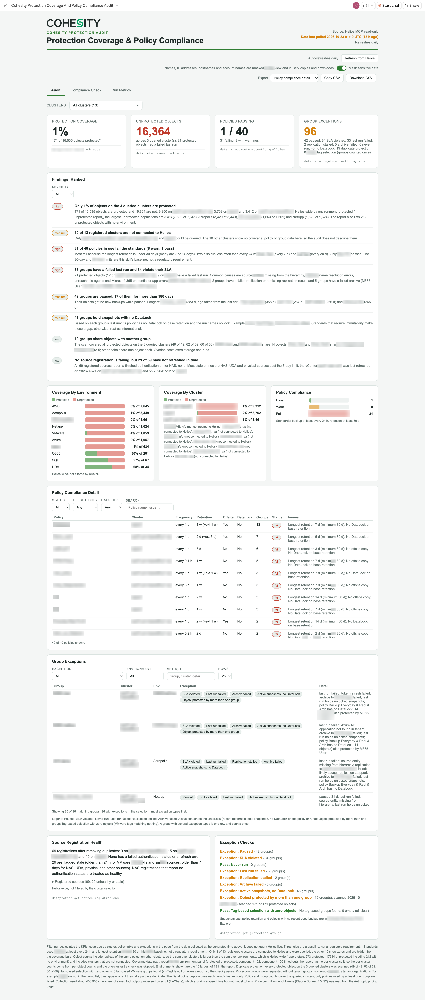
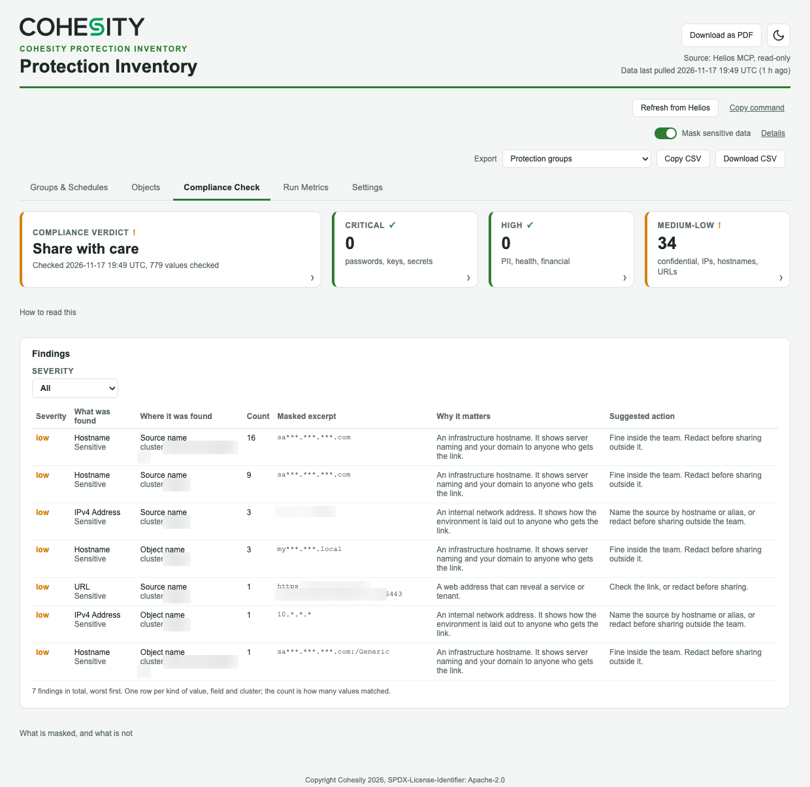
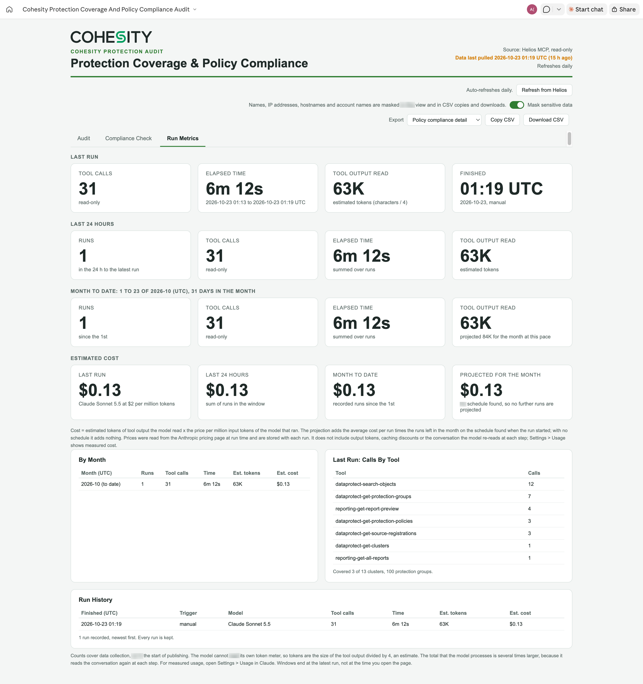

Copyright Cohesity 2026, SPDX-License-Identifier: Apache-2.0

# Protection Coverage: Claude Sample Output

Sample output of the Claude skill [`Cohesity-Protection-Coverage-Audit/SKILL.md`](Cohesity-Protection-Coverage-Audit/SKILL.md). For install and use, see the [main README](../README.md). Every page has the Cohesity logo top-left and "Data last pulled" with its age top-right, with a single sun/moon theme button (follows the browser, a click flips this view only, resets when the browser changes, nothing stored) below it and a copyright and license footer at the bottom. Screenshots are from the published artifact (lab data); hostnames, cluster names and other identifying values are blurred.

## Audit

## Compliance Check

Checks the metadata shown on the page for personal data, secrets and infrastructure details before the page is shared.

## Run Metrics

Tool calls, elapsed time, estimated tokens and estimated cost for the last run, the last 24 hours and the month to date, plus the full run history and a Tool Availability table (every Helios tool the skill can use, its status and the real reason when it is missing, disabled, not licensed or timed out). An **Audit trail** button in the Run History card opens a pop-up with what the skill did on each run (every Helios call and the decisions around it) and filters for category, status, run and text, and a CSV download. A **Pricing source** card under the cost tiles shows where the skill reads the input price from (the Anthropic pricing page by default; editors can save another link, for example a company price sheet, and the skill falls back to the default when it cannot read it).

## New in this version

The Audit tab opens with a hero ring and number tiles (with delta chips; click a tile to open the matching worklist or list), a one-line notice pill bar, a "What changed since last refresh" panel and a "Read as text" summary, and adds a Top 10 Unprotected card, a Policy By Check heat map (words as well as colour) and trend sparklines on the tiles (after 3 refreshes). A **Remediation worklist** tab ranks what to fix first by objects affected, with a CSV export. A **Download as PDF** button builds one PDF of all report tabs in the browser (each tab on its own pages, the summary once at the start, light colours, tables capped at 500 rows, 150 pages at most, masked values and shortened names stay as displayed, nothing sent anywhere; needs cdnjs.cloudflare.com; saved through the downloads capability). While the Mask sensitive data switch is on, protection group and object names are shortened to their first two letters plus `***` everywhere, including CSV and the PDF; cluster and policy names stay readable and search still matches the real names. Object counts are reused for 20 hours, so a repeat run on the same day makes about 16 Helios calls instead of about 37 for a fresh run. A refresh schedule is set in the Settings tab and exists only if you set it; without it the page does not mention refreshing. The Settings tab is the shared Settings block used by every Cohesity skill.

## About the Settings tab

A last tab shows a table of how the page uses data: **Data tools** (always on, read from your clusters) and **Cohesity AI agents** (off by default; they send details of failed backups and alerts to Cohesity's LLM subscription and drive the Priority and Why columns), with the tools used, the On/Off switch, when it was last changed (and accepted), each with "Name (email)" of the person (email masked when the mask switch is on; looked up from the viewer's profile when the first lookup lacks it) and whether it was used in the last run. Clicking the switch while it is Off opens the popup "How Cohesity handles data sent to its LLM" with an intro line, the questions Cohesity Engineering has answered and the buttons "I accept and enable Cohesity AI agents" and "Cancel"; nothing is saved before Accept, which needs the viewer's identity. The choice, and for accountability the name, email and opaque id of whoever accepted or switched it off, are saved in the artifact's own private database, not in the browser; the skill only reads it and never copies the identity into the page data. Without database access, or for a viewer who is not an editor, the switch is disabled ("Only editors of this page can change this setting"). When off, the Run Metrics Tool Availability table shows the tool as "Turned off by you" and the Audit tab says "Not shown: ... Turned off in Settings." with an "Open the Settings tab" button. The Settings table always shows the live value, so if the agents are switched on after a run, the tool shows "Off at last refresh" and the Audit tab says they were off at the last refresh and will be used on the next refresh; if they are switched off after a run that used them, the page says it still shows results from the last refresh.

**Refresh schedule.** The Settings tab has a "Refresh schedule" card. Editors choose daily, weekdays or weekly, a time, the time zone you mean (the skill converts it to the local time of the computer running Claude; daylight saving changes can shift the local run time by one hour) or off, and save: the page stores only that request in its database (`settings/schedule`). The skill never asks about a schedule. Until it is applied the card says "Not applied yet. Click Apply in Claude, then press Enter in the chat that opens."; the **Apply in Claude** link opens a Claude chat with the command typed in, and the skill then runs in schedule-only mode (no Helios calls, no troubleshooting, no new data): it creates, updates or disables the scheduled task and updates only `meter.schedule` on the page. Any normal run applies a saved request first too. The card shows what the skill saw ("In sync" or "Not applied yet"), including changes made in Claude Desktop or on the web, and the page's "Refreshes ..." texts appear only while an enabled schedule exists. The **Refresh from Helios** link and the Apply link need the Cohesity-Protection-Coverage-Audit skill (and, for refresh, the Helios connector) in the viewer's Claude and Claude open on the computer that should run the schedule; for viewers who are not signed in to Claude the buttons are disabled with a reason, and Copy command still works. Scheduled tasks may be moved to the cloud later. Only the page owner and editors can save a request, and the skill applies only time, frequency and on or off from it. The page needs the database (rule: everyone can read, only editors write) and user identity (profile, email) capabilities for this card, as for the AI switch.

## Settings

The Settings tab is the same on every Cohesity skill page. It lists what the page reads, where the data goes, and the one switch for the optional Cohesity AI agents (off by default), plus the **Refresh schedule** card.

## Audit trail

The **Audit trail** button in the Run Metrics tab (Run History card) opens a read-only list of every Helios call and decision of each run, with filters for category, status, run and search, and a CSV download.

## How Cohesity handles data sent to its LLM

Before the Cohesity AI agents can be switched on, the page shows this notice. The questions and answers are blurred in this sample; the page shows them in full.

